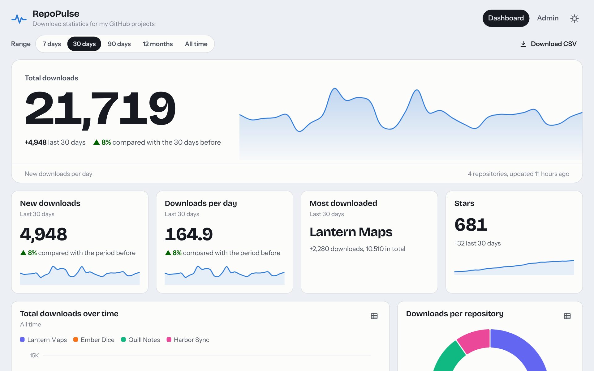

<p align="center">
  
</p>

<h1 align="center">RepoPulse</h1>

<p align="center">
  <strong>See how often your GitHub releases are downloaded, day by day.</strong><br>
  A small self-hosted dashboard: one Python process, one SQLite file, no cloud service.
</p>

<p align="center">
  <a href="https://github.com/dxcufgb/RepoPulse/actions/workflows/ci.yml"></a>
  <a href="https://github.com/dxcufgb/RepoPulse/actions/workflows/security.yml"></a>
  <a href="https://github.com/dxcufgb/RepoPulse/releases/latest"></a>
  
  
  <a href="LICENSE"></a>
</p>

<p align="center">
  <a href="https://github.com/dxcufgb/RepoPulse/wiki/Installation">Install</a> ·
  <a href="https://github.com/dxcufgb/RepoPulse/wiki/First-Steps">First steps</a> ·
  <a href="https://github.com/dxcufgb/RepoPulse/wiki/How-the-Numbers-Work">How the numbers work</a> ·
  <a href="https://github.com/dxcufgb/RepoPulse/wiki/Configuration-Reference">Configuration</a>
</p>

<picture>
  <source media="(prefers-color-scheme: dark)" srcset="docs/screenshots/dashboard-dark.png">
  
</picture>

GitHub shows only a running total of downloads for each release file; it never tells you *when* they happened.
RepoPulse asks GitHub once a day, keeps every day's numbers in a single SQLite file, and turns them into
a public page with charts and tables: new downloads per day, which release people are moving to, which file they
actually download. An admin area behind a login lets you add repositories and build the dashboard from widgets.

It runs on Windows (an installer that brings its own Python) and Linux, including a Raspberry Pi (Python 3.9 or
newer), and needs only Flask and Waitress.
The page loads nothing from the internet: fonts and Chart.js are included.

## Installation

**Windows 10/11 (64-bit):** download and run [repopulse-setup.exe](https://github.com/dxcufgb/RepoPulse/releases/latest/download/repopulse-setup.exe), an installer that brings its own Python.

**Linux, Raspberry Pi (systemd):**

```bash
curl -fLO https://github.com/dxcufgb/RepoPulse/releases/latest/download/repopulse-linux.tar.gz
tar xzf repopulse-linux.tar.gz && cd repopulse-*/
sudo ./install.sh
```

Where everything is installed, unattended installs, moving an older install and running without the installer are in the wiki:
[Installation](https://github.com/dxcufgb/RepoPulse/wiki/Installation) · [Install on Windows](https://github.com/dxcufgb/RepoPulse/wiki/Install-on-Windows) · [Install on Linux / Raspberry Pi](https://github.com/dxcufgb/RepoPulse/wiki/Install-on-Linux) · [Moving an Older Install](https://github.com/dxcufgb/RepoPulse/wiki/Moving-an-Older-Install).

## Documentation

The full guide is in the [wiki](https://github.com/dxcufgb/RepoPulse/wiki):

- [Features](https://github.com/dxcufgb/RepoPulse/wiki/Features): the dashboard, widgets and admin area, with screenshots
- [First Steps](https://github.com/dxcufgb/RepoPulse/wiki/First-Steps): log in, add repositories, build the dashboard
- [GitHub Token](https://github.com/dxcufgb/RepoPulse/wiki/GitHub-Token): rate limits and private repositories
- [Customising Charts](https://github.com/dxcufgb/RepoPulse/wiki/Customising-Charts) and [Appearance](https://github.com/dxcufgb/RepoPulse/wiki/Appearance): widget settings and the look of the page
- [Repository Pages](https://github.com/dxcufgb/RepoPulse/wiki/Repository-Pages): a page per repository
- [How the Numbers Work](https://github.com/dxcufgb/RepoPulse/wiki/How-the-Numbers-Work): new downloads per day and *Files to count*
- [Configuration Reference](https://github.com/dxcufgb/RepoPulse/wiki/Configuration-Reference): `config.json`, environment variables, reverse proxy
- [Command Line](https://github.com/dxcufgb/RepoPulse/wiki/Command-Line) and [Data and Backups](https://github.com/dxcufgb/RepoPulse/wiki/Data-and-Backups)
- [Updating](https://github.com/dxcufgb/RepoPulse/wiki/Updating): by hand and automatic updates
- [Update Emails](https://github.com/dxcufgb/RepoPulse/wiki/Update-Emails): notifications about installed and failed updates
- [Security Notes](https://github.com/dxcufgb/RepoPulse/wiki/Security-Notes) and [Troubleshooting](https://github.com/dxcufgb/RepoPulse/wiki/Troubleshooting)

## Licences

RepoPulse is released under the MIT licence (`LICENSE`). Included third-party files: Chart.js (MIT,
`repopulse/static/vendor/chart.js.LICENSE.md`), Bricolage Grotesque and
Instrument Sans (SIL Open Font License, `repopulse/static/fonts/`).
