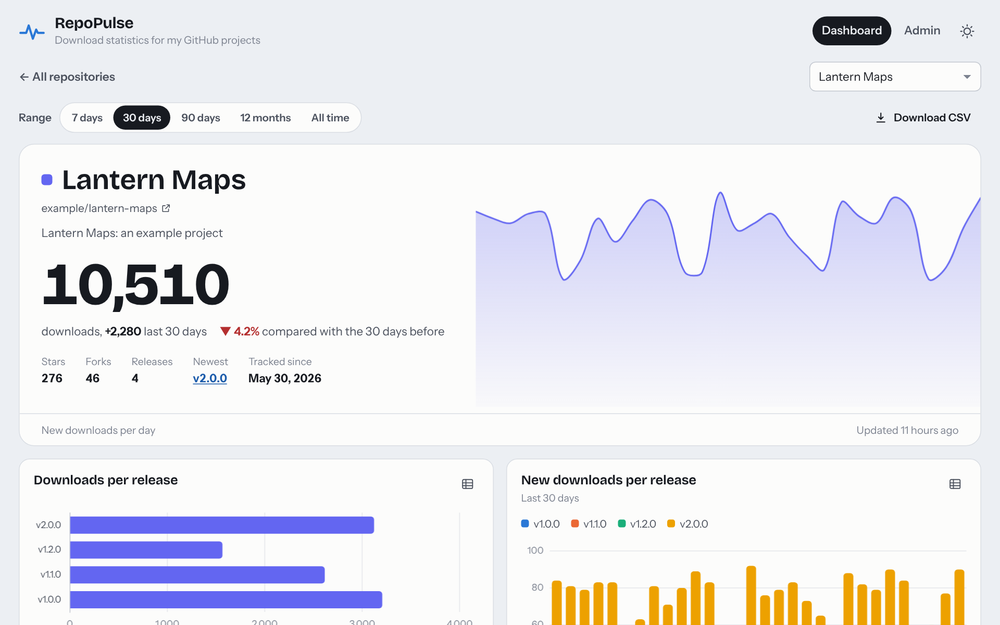
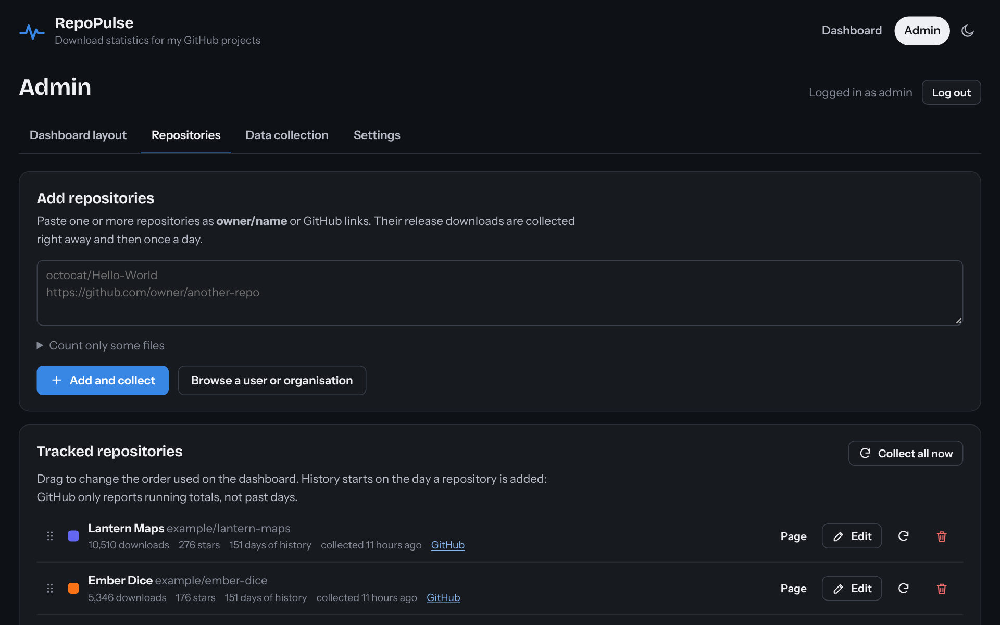

<p align="center">
  
</p>

<h1 align="center">RepoPulse</h1>

<p align="center">
  <strong>See how often your GitHub releases are downloaded, day by day.</strong><br>
  A small self-hosted dashboard: one Python process, one SQLite file, no cloud service.
</p>

<p align="center">
  <a href="https://github.com/dxcufgb/RepoPulse/actions/workflows/ci.yml"></a>
  <a href="https://github.com/dxcufgb/RepoPulse/actions/workflows/security.yml"></a>
  <a href="https://github.com/dxcufgb/RepoPulse/releases/latest"></a>
  
  
  <a href="LICENSE"></a>
</p>

<p align="center">
  <a href="#install">Install</a> ·
  <a href="#first-steps">First steps</a> ·
  <a href="#how-the-numbers-work">How the numbers work</a> ·
  <a href="#configuration">Configuration</a> ·
  <a href="#development">Development</a>
</p>

<picture>
  <source media="(prefers-color-scheme: dark)" srcset="docs/screenshots/dashboard-dark.png">
  
</picture>

GitHub shows only a running total of downloads for each release file; it never tells you *when* they happened.
RepoPulse asks GitHub once a day, keeps every day's numbers in a single SQLite file, and turns them into
a public page with charts and tables: new downloads per day, which release people are moving to, which file they
actually download. An admin area behind a login lets you add repositories and build the dashboard from widgets.

It runs on Windows and Linux (including a Raspberry Pi) with Python 3.9 or newer, and needs only Flask and Waitress.
The page loads nothing from the internet: fonts and Chart.js are included.

## What you get

- **Public dashboard** with a range switch (7 days to all time), CSV download, light and dark theme, and a layout
  that works on phones.
- **Widgets you can arrange:** headline total with a daily pulse, single numbers (new downloads, downloads per day,
  stars, forks, most downloaded repository…), line, area and bar charts over time (per day, week or month, per
  repository or combined), per-repository bars or ring charts, per-release charts for one repository, sortable
  tables, and text notes. Every chart can switch to a table view.
- **A page per repository** with downloads per release tag, how each release is picked up over time, downloads per
  file and more. Click any repository on the dashboard to open it.
- **Admin area** (login required): add repositories by name or link, browse all public repositories of a user or
  organisation and pick several at once, rename and recolour them, pause collection, hide them from the public
  page, choose which release files count, reorder them, run a collection by hand, see the collection log, change
  the collection time, GitHub token and password.

<table>
  <tr>
    <td width="50%"></td>
    <td width="50%"></td>
  </tr>
  <tr>
    <td align="center"><sub>A repository page</sub></td>
    <td align="center"><sub>The admin area (dark theme)</sub></td>
  </tr>
</table>

<sub>The screenshots show made-up example repositories.</sub>

## Install

Download the newest release (the links always point at the latest one; every release also lists versioned files and
`SHA256SUMS.txt`):

| System | Download |
| --- | --- |
| Windows 10/11 | [repopulse-windows.zip](https://github.com/dxcufgb/RepoPulse/releases/latest/download/repopulse-windows.zip) |
| Linux, Raspberry Pi, macOS | [repopulse-linux.tar.gz](https://github.com/dxcufgb/RepoPulse/releases/latest/download/repopulse-linux.tar.gz) |

### Windows

1. Install Python 3.9+ from <https://www.python.org/downloads/> and tick
   **Add python.exe to PATH** in the installer.
2. Unzip `repopulse-windows.zip` somewhere permanent, for example `C:\RepoPulse`.
3. Double-click **install.bat**. It creates a private Python environment in
   `.venv`, installs the two dependencies (Flask and Waitress), creates
   `config.json` and asks for an admin username and password (skipped when
   it runs without a console to type in, as from a script).
4. Double-click **run.bat** and open <http://localhost:8080/>.

To start RepoPulse automatically with Windows (runs in the background through
Task Scheduler), open PowerShell **as administrator** in the folder and run:

```powershell
.\install.ps1 -Service -OpenFirewall     # -OpenFirewall lets other computers reach it
.\install.ps1 -RemoveService             # undo
```

### Linux / Raspberry Pi

```bash
sudo apt install python3 python3-venv     # Debian, Ubuntu, Raspberry Pi OS
curl -fLO https://github.com/dxcufgb/RepoPulse/releases/latest/download/repopulse-linux.tar.gz
tar xzf repopulse-linux.tar.gz && cd repopulse-*/
./install.sh                # environment, config.json, admin account
./run.sh                    # start in the foreground
```

To run it as a background service that starts at boot:

```bash
./install.sh --service           # installs and starts repopulse.service (asks for sudo)
journalctl -u repopulse -f       # logs
./install.sh --remove-service    # undo
```

Use `--port 9000` with either installer to pick another port than 8080.

## First steps

1. Open `/admin` and log in. If you skipped the admin account during install,
   open `http://localhost:8080/admin` **on the server itself** to create it (for
   safety this is refused from other machines), or run
   `python -m repopulse create-admin`.
2. Under **Repositories**, paste repositories (`owner/name` or GitHub links,
   one per line) or use **Browse a user or organisation**. They are collected
   straight away.
3. Under **Settings**, add a GitHub token (optional but recommended) and pick
   the time of the daily collection.
4. Under **Dashboard layout**, choose **Edit layout** to add, edit, reorder
   (drag the grip or use the arrows), duplicate and remove widgets, then
   **Save layout**. A starter layout is used until you save your own.

## Repository pages

Every repository has its own page at `/repo/<owner>/<name>`. Open it by
clicking the repository in a table, a chart legend, a bar or a ring slice, or
with the repository menu at the top of any repository page. It shows:

- a header with the name, description, total and new downloads, stars, forks,
  newest release and a pulse of new downloads per day;
- downloads per release tag, as bars or a table;
- **releases over time**: how each release tag is picked up, day by day, which
  shows how quickly people move to a new version;
- **downloads per file**, including which files count towards the totals;
- the running total over time and a full release list.

The widgets are the same kind as on the overview, plus three that only make
sense for one repository (repository header, releases over time, files). On a
repository page every widget automatically shows the repository being viewed.

**Editing them:** in the admin area, open **Dashboard layout** and pick a
repository from **Open a repository page**, or click **Page** next to a
repository under **Repositories**. Choose **Edit repository pages**, change the
widgets, then:

- **Save for all repositories** sets the layout every repository page shares;
- **Save for &lt;repository&gt; only** gives that one repository its own layout
  (marked "own page layout" in the repository list). **Use the shared layout**
  removes it again.

Until you save anything, repository pages use a starter layout.

## How the numbers work

- GitHub reports, for every file attached to a release, a running total of
  downloads. RepoPulse stores those totals per file per day; *new downloads* on a
  day is the difference from the previous collection. If the server was off for a
  few days, the difference is spread evenly over those days.
- History starts the day a repository is added; GitHub doesn't provide past
  daily numbers. The total itself (all downloads since the release was
  published) is right from day one.
- Only release assets are counted. Clones, source-code archives (the automatic
  "Source code (zip)" links) and package registries are not part of GitHub's
  download counts.
- **Counting only some files:** a repository's *Files to count* setting takes
  patterns such as `*.zip`, `module.zip, *.exe`, or exclusions such as
  `!module.json`. Changing it recalculates the whole history. For FoundryVTT
  modules, `*.zip` is usually what you want: the `module.json` manifest is
  typically fetched on every update check, which inflates its count.

## GitHub token

Without a token GitHub allows 60 API requests per hour per IP address, which is
about 30 repositories per collection (two requests each). With a token it is 5,000 per hour, and
private repositories become readable. A fine-grained personal access token with
read-only access to public repositories is enough
(GitHub → Settings → Developer settings → Personal access tokens). The token is
stored in the database on your server and never sent to the browser.

## Configuration

`config.json` holds the server settings (everything else is edited in the admin
area). It is plain UTF-8 JSON (a byte-order mark, as Notepad or Windows PowerShell
may add, is fine). Each value can also be set with an environment variable such as
`REPOPULSE_PORT=9000`.

| Setting | Default | Meaning |
|---|---|---|
| `host` | `0.0.0.0` | Network address to listen on. `127.0.0.1` = this computer only. |
| `port` | `8080` | Port number. |
| `data_dir` | `data` | Folder for the database and the session key. |
| `behind_proxy` | `false` | Set to `true` behind nginx, Caddy, IIS or similar so client addresses and https are detected. |
| `secure_cookies` | `false` | Set to `true` when the site is served over https. |
| `allow_remote_setup` | `false` | Allow creating the first admin account from another computer. |
| `github_api_url` | `https://api.github.com` | Change for GitHub Enterprise Server. |
| `threads` | `8` | Web server worker threads. |

If the dashboard is reachable from the internet, put it behind a reverse proxy
with https and set `behind_proxy` and `secure_cookies` to `true`. Example for
Caddy: `stats.example.com { reverse_proxy localhost:8080 }`.

## Command line

Run these in the RepoPulse folder with `.venv/bin/python` (Linux) or
`.venv\Scripts\python` (Windows):

```
python -m repopulse serve [--port 9000] [--no-scheduler]
python -m repopulse collect          # collect now, e.g. from cron
python -m repopulse create-admin
python -m repopulse set-password     # also the way to reset a forgotten password
python -m repopulse status
```

## Data and backups

Everything lives in `data/repopulse.db` (plus `data/secret.key`, which signs
login sessions). Copy the `data` folder to back up; the admin Settings page and
the public dashboard also offer a CSV export.

## Updating

Stop RepoPulse, replace the program files (keep `data/` and `config.json`),
run the installer again, start it.

## Security notes

- Passwords are hashed (PBKDF2-SHA256, 600,000 rounds). Five failed logins from
  one address lock that address out for five minutes.
- Admin requests need both the session cookie and a CSRF token; the page sends a
  strict Content-Security-Policy.
- Changing a password (in Settings or with `set-password`) logs out every other
  session of that account.
- `serve` warns when it listens on a network address over plain HTTP: put it
  behind a reverse proxy with https (see Configuration) or bind it to `127.0.0.1`.
- The public dashboard can be switched off in Settings, which puts the whole
  page behind the login.

## Development

```bash
python -m venv .venv && .venv/bin/pip install -r requirements.txt     # Windows: .venv\Scripts\pip
.venv/bin/python -m unittest discover -s tests -t .                   # the tests (standard library unittest)
.venv/bin/python -m repopulse serve --no-scheduler                    # run it without the daily collection
```

The tests need no network: GitHub is faked. Every push and pull request runs the GitHub Actions workflows in
`.github/workflows/`:

- **CI** (`ci.yml`): the tests on Python 3.9 and 3.13 on Linux and Windows, shellcheck, PSScriptAnalyzer on
  `install.ps1`, a real `./install.sh --service` (systemd) and `.\install.ps1 -Service` (Task Scheduler) install
  that must start and answer, and the release build.
- **Security** (`security.yml`, also weekly): gitleaks over the whole history, Semgrep, and `pip-audit` on
  `requirements.txt`. The same checks locally:

  ```bash
  gitleaks git --redact --log-opts="--full-history --diff-filter=tuxdb --diff-merges=first-parent HEAD" .
  semgrep scan --metrics=off --error --severity WARNING --severity ERROR --config p/python --config p/javascript \
    --config p/security-audit --config p/secrets --config p/github-actions --config r/bash
  pip-audit -r requirements.txt
  ```

  A Semgrep false positive gets an inline `# nosemgrep: <rule-id>` (`// nosemgrep: <rule-id>` in JavaScript) with
  the reason, on the line or the line before it.
- **Workflow lint** (actionlint and zizmor) when `.github/` changes, and **Claude** reviews of pull requests.

`main` is protected by the "Protect main" ruleset (`.github/ruleset-protect-main.json`): changes go through a pull
request with one approval and every check above (except Workflow lint and Claude) green, and are squash-merged with
the pull request's title and description. Release tags `v*` cannot be moved or deleted ("Protect release tags").
Dependabot keeps the pinned GitHub Actions and the Python dependencies up to date with one grouped pull request a
week each. Bugs and ideas go in the issue templates; security problems are reported privately
([`.github/SECURITY.md`](.github/SECURITY.md)).

### Releasing

Actions → **Release** → Run workflow → type the version (for example `1.2.0`; `1.2.0-rc.1` makes a pre-release).
It runs the whole CI, builds `repopulse-<version>-linux.tar.gz` and `repopulse-<version>-windows.zip` (plus the
same files as `repopulse-linux.tar.gz` / `repopulse-windows.zip`, so
`https://github.com/dxcufgb/RepoPulse/releases/latest/download/repopulse-linux.tar.gz` is always the newest) with
the version stamped in, and `SHA256SUMS.txt`, and publishes the release. Nobody edits the version in
`repopulse/__init__.py` by hand. `scripts/build-release.sh dist 1.2.0` builds the same files locally.

### The GitHub repository

`scripts/setup-repo.sh` creates the GitHub repository (or re-applies its settings): it commits what is not committed
yet, pushes `main`, sets the description, topics and merge settings (squash merges only, branches deleted after
merging), the security settings (secret scanning with push protection, Dependabot alerts and updates, private
vulnerability reporting, CodeQL), creates the rulesets in `.github/` (protected `main`,
protected `v*` tags) and starts the first release. It needs the GitHub CLI logged in with
`gh auth login --scopes repo,workflow`; `--dry-run` shows what it would do and `--help` lists the options.

## Licences

RepoPulse is released under the MIT licence (`LICENSE`). Included third-party files: Chart.js (MIT,
`repopulse/static/vendor/chart.js.LICENSE.md`), Bricolage Grotesque and
Instrument Sans (SIL Open Font License, `repopulse/static/fonts/`).
